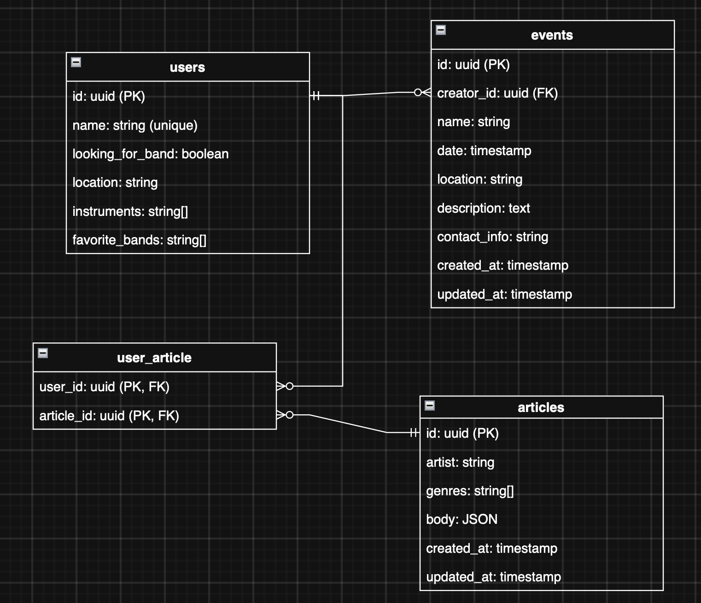

# Lab project description

## Website topic: Music forum

## Music forum will have core pages

- Articles
- Events
- Find Band

## Articles page

Music forum users can read and create wiki pages about artists, add changes to existing ones. All changes (including article creation)

## Events page

On events page visitors can view or create musical event announcements. Users are able to view more details about event on event's own page

## Find Band

Page to find people to play with. Users with `I want to find a band` tick in their profile appear on that page for other user's searches.
Displayed with short information of instruments they play on, their favourite bands, their name or nickname, location where they are available to play.
To see detailed info on a user we can navigate to his profile

## User profile

On this page profile owner can configure his nickname (which must be unique across the platform), favorite bands and their intruments, band availability and location.

For view all the information above is available, plus articles that were written/participated by the person.

## Core Endpoints

### Artists

`GET` /kmartists/artists/ - Get articles about artists. Has pagination and basic filters like genre and search query

Request params:

```json
    {
        "take": number,
        "skip": number,
        "genre": string,
        "search_query": string
    }
```

Response body:

```json
    {
        "items": { "id": string, "artist": string, "genres": string[] }[],
        "pagination": { "current_page": number, "total_pages": number, "total_records": number }
    }
```

`GET` /kmartists/artists/{id}/ - Get specific artist article.

Response body:

```json
    {
        "id": string,
        "artist": string,
        "genres": string[],
        "body": { "title": string, "content": string }[],
        "contributors": { "id": string, "name": string }[],
        "created_at": string,
        "updated_at": string
    }
```

`POST` /kmartists/artists/ - Create an article about artist.

Request body:

```json
    {
        "artist": string,
        "genres": string[],
        "body": { "title": string, "content": string }[]
    }
```

Response body:

```json
    {
        "id": string
    }
```

`PUT` /kmartists/artists/{id}/ - Make edits to existing artist article

Request body:

```json
    {
        "genres": string[],
        "body": { "title": string, "content": string }[]
    }
```

`DELETE` /kmartists/artists/{id}/ - Delete artist article

### Genres

`GET` /kmartists/genres/ - Get all unique genres used in artist articles, sorted alphabetically. Used to build the genre filter.

Response body:

```json
    {
        "items": string[]
    }
```

### Events

`GET` /kmartists/events/ - list events

Request params:

```json
    {
        "take": number,
        "skip": number,
        "search_query": string,
        "location": string,
        "date": string
    }
```

Response body:

```json
    {
        "items": { "id": string, "name": string, "date": string, "location": string }[],
        "pagination": { "current_page": number, "total_pages": number, "total_records": number }
    }
```

`GET` /kmartists/events/{id}/ - Get specific event detailed info

Response body:

```json
    {
        "id": string,
        "name": string,
        "date": string,
        "location": string,
        "description": string,
        "contact_info": string,
        "creator": { "id": string, "name": string },
        "created_at": string,
        "updated_at": string
    }
```

`POST` /kmartists/events/ - Create new music event announcement

Request body:

```json
    {
        "name": string,
        "date": string,
        "location": string,
        "description": string,
        "contact_info": string
    }
```

Response body:

```json
    {
        "id": string
    }
```

`PUT` /kmartists/events/{id}/ - Make changes to event (available only for event creator)

Request body:

```json
    {
        "name": string,
        "date": string,
        "location": string,
        "description": string,
        "contact_info": string
    }
```

`DELETE` /kmartists/events/{id}/ - Delete event

### Users

`GET` /kmartists/users/musicians/ - Get list of users available to play in band

Request params:

```json
    {
        "take": number,
        "skip": number,
        "location": string,
    }
```

Response body:

```json
    {
        "items": {
            "id": string,
            "name": string,
            "instruments": string[],
            "favorite_bands": string[],
            "location": string
        }[],
        "pagination": { "current_page": number, "total_pages": number, "total_records": number }
    }
```

`GET` /kmartists/users/{id}/ - Get specific user profile

Response body:

```json
    {
        "id": string,
        "name": string,
        "instruments": string[],
        "favorite_bands": string[],
        "looking_for_band": boolean,
        "location": string
    }
```

`GET` /kmartists/users/{id}/articles/ - Get user's articles

Response body:

```json
    {
        "items": { "id": string, "artist": string, "genres": strin[] }[],
        "pagination": { "current_page": number, "total_pages": number, "total_records": number }
    }
```

`PUT` /kmartists/users/{id}/ - Make changes to user profile (only for profile owner)

## Database diagram


